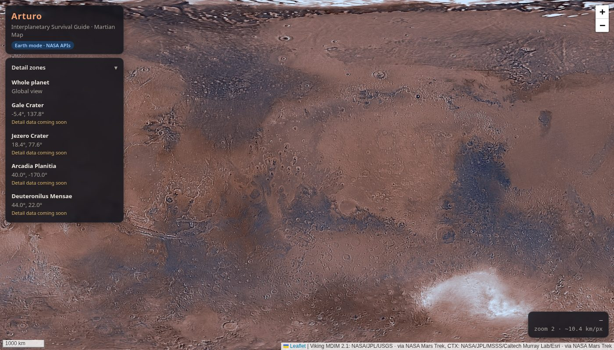
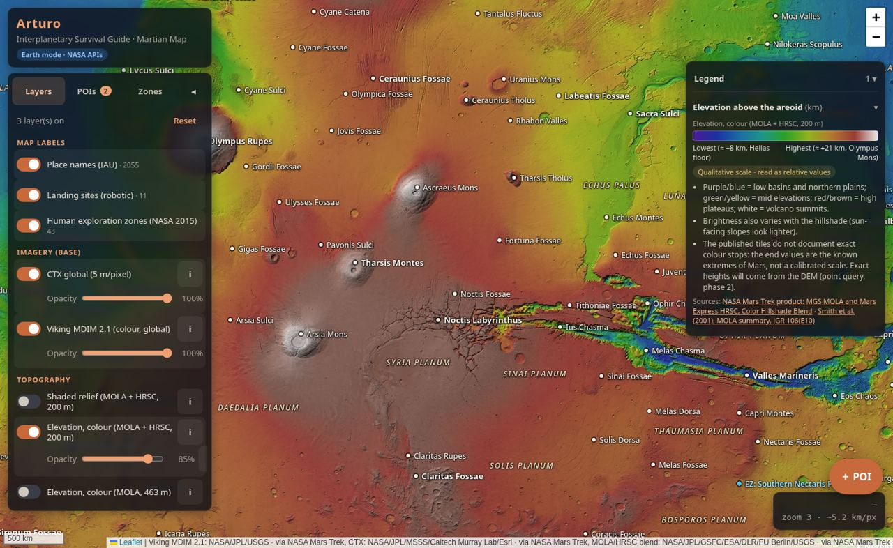
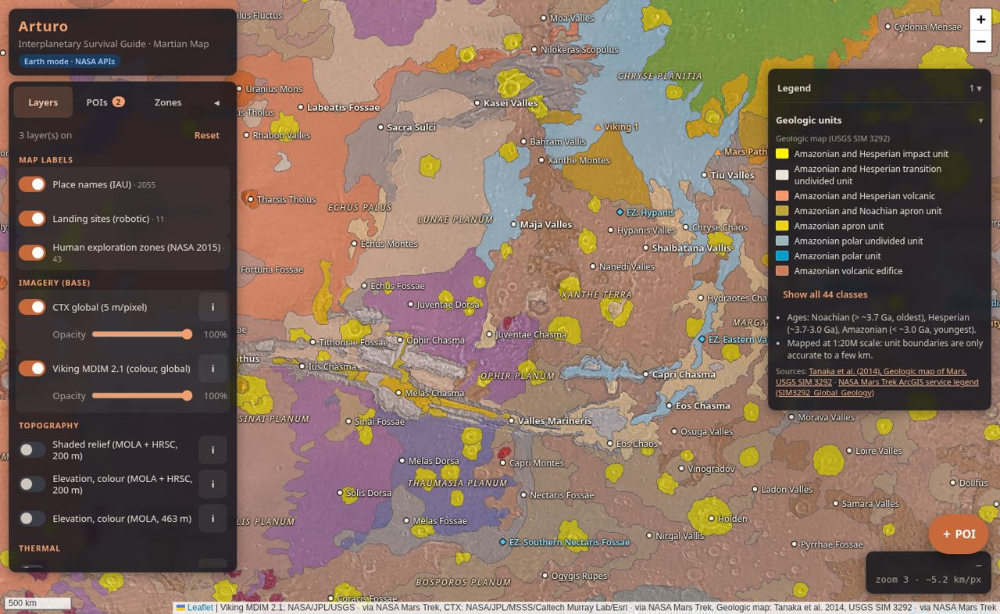
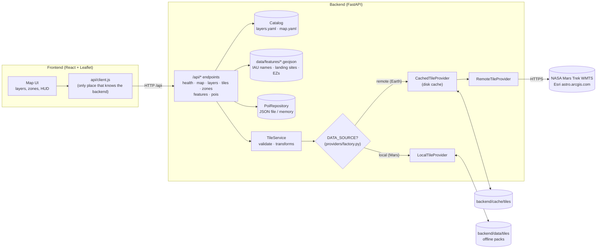

# Arturo — Interplanetary Survival Guide: Martian Map

> NASA Space Apps Challenge 2026 · Challenge:
> [Interplanetary Survival Guide: Martian Map](https://www.spaceappschallenge.org/2026/challenges/interplanetary-survival-guide-martian-map/?tab=details)

**Arturo** is a layered 2D map of Mars designed as a *survival guide* for
astronauts: not just a pretty viewer, but a tool to plan safe and
scientifically valuable traverses (slopes, hazards, radiation, temperature,
water and shelter) that **works without a connection to Earth**.



| Jezero crater, CTX 5 m/px (zoom 9) | Gale crater in Mars mode (offline, local data) |
|---|---|
|  |  |

| Phase 1b: 16 layers with legends (colour elevation) | Place names decluttered by importance (Gale, zoom 9) |
|---|---|
|  |  |
| **Geologic map with a categorical legend** | **Manual POIs: add with a button, tap, fill the form** |
|  |  |

---

## Table of contents

1. [The challenge and our approach](#1-the-challenge-and-our-approach)
2. [Current status](#2-current-status)
3. [Architecture](#3-architecture)
4. [Earth mode vs Mars mode](#4-earth-mode-vs-mars-mode)
5. [Repository structure](#5-repository-structure)
6. [Running the project step by step](#6-running-the-project-step-by-step)
7. [Environment variables](#7-environment-variables)
8. [API endpoints](#8-api-endpoints)
9. [Data sources and attributions](#9-data-sources-and-attributions)
10. [Roadmap](#10-roadmap)
11. [How to add a new layer](#11-how-to-add-a-new-layer)
12. [Decisions and why](#12-decisions-and-why)
13. [Known limitations](#13-known-limitations)
14. [Contributing (commits, branches)](#14-contributing)

---

## 1. The challenge and our approach

The challenge asks for a layered map of Mars, for one region or route,
that combines data from several NASA missions and helps an astronaut plan
a safe and scientifically interesting walk.

Interactive viewers such as NASA Mars Trek already exist, but they are
built for scientists on Earth with a permanent Internet connection. Our
angle is different:

- **A survival guide, not a viewer**: routes that avoid dangerous slopes,
  radiation and temperature warnings by time and season, points of
  interest (water ice, shelter, science targets).
- **Offline-first**: a radio signal takes **4 to 24 minutes** each way
  between Mars and Earth, so depending on a remote API is not realistic.
  Everything the astronaut needs lives on the device/habitat; updates
  arrive as packs.
- **Hybrid level-of-detail model**: the whole planet at low resolution
  (always available, a few GB) plus downloadable **detail zones** at high
  resolution (rover sites like Gale and Jezero, and candidate human
  landing regions with shallow ice like Arcadia Planitia and Deuteronilus
  Mensae).

## 2. Current status

**Phase 1 — done ✅**: global Mars map with pan, zoom and level of detail
(LOD), base satellite imagery, backend tile proxy with interchangeable
data providers (Earth/Mars), disk cache that doubles as an offline pack,
detail-zones menu (auto-zoom; detailed data comes later).

**Phase 1b — done ✅**:

- **16 global layers** from NASA Mars Trek (imagery, topography, thermal,
  surface properties, mineralogy, geology, hydrology), each one verified
  to serve tiles and to line up with the base. A layer panel lets you
  switch each one on/off, set its opacity and reorder it (touch-friendly,
  remembered between visits).
- **A legend per layer**, with its metadata coming from the backend. Where
  NASA does not publish the colour ramp, the legend says so: it is marked
  *qualitative* and cites the source.
- **Map labels**: ~2,000 IAU place names (craters, valleys, mountains…),
  11 robotic landing sites and 43 candidate human exploration zones.
  They are served by `GET /api/features` from pre-built GeoJSON files, so
  this **works offline**. Labels are hidden by **importance** (size and
  type) and by **on-screen collision**, so the map never gets cluttered.
- **Manual points of interest (POIs)**: tap **＋ POI**, then tap the map.
  No right-click is needed, so it works on touch screens. A POI has an
  icon type (resource, shelter, hazard, vehicle, unknown), a name and
  notes. It remembers the **zoom it was created at**. A POI created
  zoomed in is a *local* POI and hides when you zoom far out. A POI
  created zoomed out is a *world-view* POI and is always shown. POIs can
  be edited and deleted. They are stored by the backend (`/api/pois`)
  behind a storage abstraction (JSON file today, database later).

See the [roadmap](#10-roadmap) for what comes next.

---

## 3. Architecture

Monorepo with two top-level folders:

- **`frontend/`** — React + Vite + Leaflet (react-leaflet). 2D only.
- **`backend/`** — Python + FastAPI. Later: rasterio, numpy, scikit-image
  for GeoTIFF queries and routing.

The **golden rule**: *the frontend only talks to our backend*. The backend
is a black box that decides where the data comes from.



Key pieces:

| Piece | Where | Role |
|---|---|---|
| Layer catalog | `backend/app/catalog/layers.yaml` | Single source of truth: which layers exist, their tile grid, zoom ranges, attribution and (privately) their remote URL. |
| Map config & zones | `backend/app/catalog/map.yaml` | Initial view, zoom limits, Mars radius, detail zones, POI categories and POI zoom rules. |
| Feature repository | `backend/app/repositories/features.py` | Reads the pre-built label GeoJSON files and answers bbox + zoom queries (handles the ±180° line). |
| POI repository | `backend/app/repositories/pois.py` | `PoiRepository` interface with in-memory and JSON-file stores. A database store would be one new class. |
| `TileProvider` interface | `backend/app/providers/base.py` | `get_tile(layer, z, x, y) -> Tile`. Any source implements just this. |
| Provider factory | `backend/app/providers/factory.py` | **The one Earth/Mars switch**, driven by `DATA_SOURCE`. |
| API client | `frontend/src/api/client.js` | The only frontend file that calls the backend. |
| Map component | `frontend/src/components/MarsMap.jsx` | Renders whatever layers `/api/layers` announces, with the options it sends. |
| Labels | `frontend/src/components/FeatureLabels.jsx` + `map/declutter.js` | Fetches labels for the visible area and hides the ones that would overlap. |
| POIs | `frontend/src/components/PoiLayer.jsx`, `PoiSheet.jsx`, `hooks/usePois.js` | Shows, creates, edits and deletes POIs through the API. |

More detail: [`backend/README.md`](backend/README.md) and
[`frontend/README.md`](frontend/README.md).

## 4. Earth mode vs Mars mode

| | 🌍 Earth mode (hackathon demo) | 🔴 Mars mode (deployment on Mars) |
|---|---|---|
| Setting | `DATA_SOURCE=remote` (default) | `DATA_SOURCE=local` |
| Where tiles come from | NASA Mars Trek / Esri over the Internet | Local folder (`LOCAL_TILES_DIR`); later a local DB or Martian network |
| Cache | Every visited tile is saved in `backend/cache/tiles` | — |
| Frontend changes | — | **none** |
| Backend changes | — | **none** (an env var). A brand-new kind of source = one new provider class + one line in the factory |
| Labels (`/api/features`) | Local GeoJSON files (already offline) | Same files |
| POIs (`/api/pois`) | JSON file (`POI_STORE=json`) | Same, or a future database / synced store behind `PoiRepository` |

How to switch:

```bash
# in backend/.env
DATA_SOURCE=local
LOCAL_TILES_DIR=./data/tiles     # or ./cache/tiles to reuse what you browsed
```

The cache and the offline packs use **the same folder layout**
(`{layer}/{z}/{x}/{y}.{ext}`), so a demo can be: browse a zone with
Internet → cut the network → switch to Mars mode → everything you
visited keeps working. The header badge in the UI shows the active mode.
Packs can also be built in advance with `backend/scripts/prefetch_tiles.py`:

```bash
cd backend
python -m scripts.prefetch_tiles --layer all --max-level 3   # every layer, whole planet, ~89 MB
```

Labels (`/api/features`) are already local files, so they work in both
modes with no extra step.

---

## 5. Repository structure

```
Arturo/
├── README.md                 ← you are here
├── docs/img/                 screenshots used in the READMEs
├── backend/                  Python API (FastAPI)
│   ├── README.md             backend docs (setup, API, architecture)
│   ├── requirements.txt      runtime dependencies
│   ├── requirements-dev.txt  + pytest, pyshp (feature build script)
│   ├── .env.example          all settings, commented
│   ├── app/
│   │   ├── main.py           FastAPI app, CORS, routers, provider lifecycle
│   │   ├── core/config.py    settings from env vars / .env
│   │   ├── api/              endpoints: health, map, layers, tiles, features, pois
│   │   ├── catalog/          layers.yaml, map.yaml and their loaders
│   │   ├── models/           Pydantic models (internal vs public contract)
│   │   ├── providers/        TileProvider + remote / local / cached + factory
│   │   ├── repositories/     feature (labels) and POI storage abstractions
│   │   └── services/         TileService, tile transforms, label ranking
│   ├── scripts/              prefetch_tiles.py (offline packs), build_features.py (labels)
│   ├── data/features/        label GeoJSON (IAU names, landing sites, EZs) — in git
│   ├── data/pois/            user POIs (pois.json, not in git)
│   ├── data/tiles/           offline packs (contents not in git)
│   └── tests/                pytest suite (offline)
└── frontend/                 Web app (React + Vite + Leaflet)
    ├── README.md             frontend docs
    ├── package.json
    ├── vite.config.js        dev server + /api proxy
    ├── .env.example
    └── src/
        ├── api/client.js     backend client (only place with the API URL)
        ├── hooks/            useBackendData, useLayerState, useLabelState, usePois
        ├── map/              Mars CRS, URL hash, label declutter, POI icons and zoom rules
        └── components/       MarsMap, Sidebar (Layers / POIs / Zones), LayersPanel,
                              LegendPanel, FeatureLabels, PoiLayer, PoiSheet, PoiPanel, …
```

---

## 6. Running the project step by step

You need **two terminals**: one for the backend and one for the frontend.

### Requirements

- **Python 3.10 or newer** — https://www.python.org/downloads/
  (Windows: tick "Add Python to PATH" in the installer).
- **Node.js 20.19+ or 22.12+** (LTS recommended) — https://nodejs.org/
- **Git** — https://git-scm.com/
- Internet connection (Earth mode downloads tiles from NASA).

### 0. Clone

```bash
git clone https://github.com/JorgeGomezSanchez/Arturo.git
cd Arturo
```

### 1. Backend (terminal 1)

**Linux / macOS**

```bash
cd backend
python3 -m venv .venv
source .venv/bin/activate
pip install -r requirements.txt
cp .env.example .env            # optional
uvicorn app.main:app --reload --port 8000
```

**Windows (PowerShell)**

```powershell
cd backend
py -3 -m venv .venv
.\.venv\Scripts\Activate.ps1     # if blocked: Set-ExecutionPolicy -Scope CurrentUser RemoteSigned
pip install -r requirements.txt
copy .env.example .env           # optional
uvicorn app.main:app --reload --port 8000
```

**fish shell**: activate with `source .venv/bin/activate.fish` (the
plain `activate` script is for bash/zsh).

**Windows (cmd.exe)**: same as PowerShell but activate with
`.venv\Scripts\activate.bat`.

Check that it is running:

- http://localhost:8000/ — a small JSON index with links to everything
  below. Earlier versions returned `404` here because the API lives under
  `/api`. That was by design, but it was confusing, so the root now shows
  this index.
- http://localhost:8000/api/health — status and active data source.
- http://localhost:8000/docs — **interactive API docs** (Swagger UI): every
  endpoint, its parameters and a "Try it out" button. This is the easiest
  way to explore the API. ReDoc is at `/redoc`.

### 2. Frontend (terminal 2) — same on every OS

```bash
cd frontend
npm install
npm run dev
```

Open **http://localhost:5173** 🚀

Tips:

- Shareable views: the URL keeps `#zoom/lat/lon`, e.g.
  http://localhost:5173/#6/-5.4/137.8 is Gale crater.
- The first visit to an area is slower (tiles come from NASA); after that
  they come from the backend's disk cache.
- **Layers** tab: switch layers on/off, change opacity, move them up/down,
  and open the legend of each one (ⓘ). **POIs** tab: your points of
  interest. **Zones** tab: detail zones.
- Add a POI: tap **＋ POI** (bottom right), tap the map, fill the form.
  Press `Esc` or *Cancel* to stop placing.

### 3. Tests (optional)

```bash
cd backend
pip install -r requirements-dev.txt
python -m pytest -q
```

---

## 7. Environment variables

### Backend (`backend/.env`, see `backend/.env.example`)

| Variable | Default | Description |
|---|---|---|
| `DATA_SOURCE` | `remote` | `remote` = Earth mode (NASA APIs + cache), `local` = Mars mode (disk only). |
| `LOCAL_TILES_DIR` | `./data/tiles` | Offline packs for local mode. |
| `TILE_CACHE_ENABLED` | `true` | Save downloaded tiles to disk in remote mode. |
| `TILE_CACHE_DIR` | `./cache/tiles` | Cache folder (same layout as the packs). |
| `REMOTE_TIMEOUT_S` | `15` | Timeout for NASA/Esri requests. |
| `REMOTE_USER_AGENT` | `Arturo/0.1 (...)` | User-Agent for remote requests. |
| `LAYERS_FILE` | `app/catalog/layers.yaml` | Layer catalog. |
| `MAP_FILE` | `app/catalog/map.yaml` | Map config, zones, POI categories and zoom rules. |
| `FEATURES_DIR` | `./data/features` | Folder with the label GeoJSON files served by `/api/features`. |
| `POI_STORE` | `json` | POI storage: `json` (file, survives restarts) or `memory` (lost on restart). |
| `POI_STORE_FILE` | `./data/pois/pois.json` | File used by the JSON POI store (created on first write). |
| `CORS_ORIGINS` | `http://localhost:5173,...` | Allowed origins when not using the Vite proxy. |

### Frontend (`frontend/.env.local`, see `frontend/.env.example`)

| Variable | Default | Description |
|---|---|---|
| `VITE_API_URL` | *(empty = same origin)* | Backend URL as seen by the browser. Leave empty in development. |
| `VITE_DEV_BACKEND` | `http://127.0.0.1:8000` | Target of the Vite dev proxy for `/api`. |

---

## 8. API endpoints

Interactive docs at http://localhost:8000/docs.

| Method | Path | Description | Phase |
|---|---|---|---|
| GET | `/api/health` | Status, version, data source (`remote`/`local`), active provider | 1 ✅ |
| GET | `/api/map` | CRS, Mars radius, initial view, zoom limits, bounds | 1 ✅ |
| GET | `/api/layers` | Layers with Leaflet-ready options; `tileUrl` points to our backend | 1 ✅ |
| GET | `/api/layers/{id}` | One layer | 1 ✅ |
| GET | `/api/tiles/{layer}/{z}/{x}/{y}` | Tile image (404 = no data, 502 = source failed) | 1 ✅ |
| GET | `/` | Small JSON index with links (`/docs`, `/api/health`, …) | 1b ✅ |
| GET | `/api/zones` | Detail zones for the side menu | 1 ✅ (stub data) |
| GET | `/api/features?bbox=&zoom=&categories=&limit=` | Map labels (IAU names, landing sites, exploration zones) visible in a bbox at a zoom, most important first (GeoJSON) | 1b ✅ |
| GET | `/api/features/categories` | Label categories with counts | 1b ✅ |
| GET | `/api/features/{id}` | One label feature | 1b ✅ |
| GET | `/api/pois?bbox=` | Manual POIs (GeoJSON FeatureCollection) | 1b ✅ |
| POST | `/api/pois` | Create a POI → `201` + GeoJSON Feature | 1b ✅ |
| GET / PUT / DELETE | `/api/pois/{id}` | Read, update or delete one POI | 1b ✅ |
| GET | `/api/pois/categories` | POI icon types with label, description and colour (the zoom rules are in `/api/map` → `poiVisibility`) | 1b ✅ |
| GET | `/api/point?lat=&lon=` | Values at a point: elevation, slope, estimated temperature, radiation | 2 |
| POST | `/api/route` | Safe route between two points (GeoJSON + elevation profile + hazards) | 3 |

---

## 9. Data sources and attributions

| Data | Provider / credits | Used for | Link |
|---|---|---|---|
| Viking MDIM 2.1 colour mosaic, ~232 m/px | NASA / JPL / USGS, served by NASA Mars Trek | Global colour base (zoom 0-7+) | [WMTS capabilities](https://trek.nasa.gov/tiles/Mars/EQ/Mars_Viking_MDIM21_ClrMosaic_global_232m/1.0.0/WMTSCapabilities.xml) |
| CTX global mosaic, ~5 m/px | NASA / JPL / MSSS / Caltech Murray Lab / Esri; listed in NASA Mars Trek, tiles from Esri's `astro.arcgis.com` | High-resolution base (zoom 7+) | [WMTS capabilities](https://trek.nasa.gov/tiles/Mars/EQ/CTX_beta01_uncontrolled_5m_Caltech/1.0.0/WMTSCapabilities.xml) · [Esri MapServer](https://astro.arcgis.com/arcgis/rest/services/OnMars/CTX/MapServer) |
| MOLA colour hillshade, 463 m/px | NASA / JPL / GSFC (MGS MOLA) | Colour elevation | [Mars Trek](https://trek.nasa.gov/mars/) |
| MOLA + HRSC blend, 200 m/px (colour and grey shaded relief) | NASA / JPL / GSFC / ESA / DLR / FU Berlin / USGS | Colour elevation, shaded relief | [Mars Trek](https://trek.nasa.gov/mars/) |
| THEMIS day and night IR controlled mosaics, 100 m/px | NASA / JPL / ASU (Edwards et al. 2011; USGS 2018) | Thermal imagery | [Mars Trek](https://trek.nasa.gov/mars/) |
| TES thermal inertia | NASA / JPL / ASU (Putzig et al. 2005) | Thermal inertia | [Mars Trek](https://trek.nasa.gov/mars/) |
| TES albedo, TES dust cover index | NASA / JPL / ASU (Ruff & Christensen 2002) | Surface brightness and dust | [Mars Trek](https://trek.nasa.gov/mars/) |
| MOLA roughness | NASA / GSFC (Kreslavsky & Head 2000) | Surface roughness | [Mars Trek](https://trek.nasa.gov/mars/) |
| TES mineral maps (high-Ca pyroxene, plagioclase, sheet silicates/glass) | NASA / JPL / ASU (Bandfield 2002) | Mineralogy | [Mars Trek](https://trek.nasa.gov/mars/) |
| Geologic map of Mars, SIM 3292 | Tanaka et al. 2014, USGS | Geology (categorical legend with 44 units) | [USGS](https://doi.org/10.3133/sim3292) |
| Valley networks | Hynek et al. 2010 | Ancient valleys | [Mars Trek](https://trek.nasa.gov/mars/) |
| IAU Gazetteer of Planetary Nomenclature | IAU WGPSN / USGS Astrogeology | ~2,000 place-name labels | [Gazetteer](https://planetarynames.wr.usgs.gov/) |
| Human exploration zones (2015 workshop) | NASA, EZMars layer of Mars Trek | 43 candidate human landing zones | [EZMars MapServer](https://trek.nasa.gov/mars/trekarcgis/rest/services/EZMars/MapServer) |
| Robotic landing sites | Hand-curated from NASA/ESA/CNSA mission pages | 11 landing-site labels | `backend/data/features/README.md` |
| NASA Mars Trek | NASA Solar System Treks Project (JPL) | Tile services (WMTS) | https://trek.nasa.gov/mars/ |

Full layer metadata (resolution, coverage, legend, references with DOIs)
lives in `backend/app/catalog/layers.yaml` and is shown in each layer's
legend. Planned for later phases: HiRISE images and DTMs (MRO), MSL/RAD
radiation measurements (Curiosity), NASA Ames Mars climate model.

Attributions are shown in the map's bottom-right corner and are defined
per layer in `layers.yaml`.

---

## 10. Roadmap

| Phase | Goal | Main work |
|---|---|---|
| **1 ✅** | Global map | Whole-Mars 2D map with pan/zoom/LOD, base imagery (Viking + CTX), backend proxy with Earth/Mars providers, cache/offline packs, zones menu stub. |
| **1b ✅** | Layers, labels, POIs | 16 toggleable layers with legends; IAU / landing-site / exploration-zone labels with decluttering (`/api/features`); manual POIs with CRUD (`/api/pois`); layer panel with opacity and order. |
| **2** | Point query | Click anywhere → elevation, slope, estimated temperature, radiation. Backend reads GeoTIFFs with rasterio (global MOLA DEM ~463 m/px; per-zone HiRISE DTMs) → `GET /api/point`. |
| **3** | Safe routes | Slope map from the DEM, hazard mask above a threshold angle, A* (scikit-image) between two points → `POST /api/route` returning GeoJSON with elevation profile, distance and hazard warnings. |
| **Extras** | Survival guide | Detail-zone packs (HiRISE) downloadable from the side menu; time/season-aware temperature and radiation warnings; offline pack manager; Service Worker for a fully offline frontend; printable traverse plan. |

---

## 11. How to add a new layer

Example: a MOLA hillshade from Mars Trek.

1. Open its capabilities, e.g.
   `https://trek.nasa.gov/tiles/Mars/EQ/<LAYER_NAME>/1.0.0/WMTSCapabilities.xml`.
   Note: `ResourceURL template`, `TileWidth` (256/512), number of
   `TileMatrix` levels, `Format`. Use **EQ** (equirectangular) layers only.
2. Add an entry to `backend/app/catalog/layers.yaml`:

   ```yaml
   - id: my_new_layer
     name: "My new layer"
     description: "What it shows and why an astronaut cares"
     group: overlay            # toggleable (base = imagery under everything)
     category: topography      # panel section: imagery, topography, thermal, surface, composition, geology, hydrology
     default_visible: false
     format: png
     tile_size: 256
     levels: { min: 0, max: 7 }
     display: { min_zoom: 0, max_zoom: 18 }
     opacity: 0.6
     z_index: 15
     resolution_m: 463
     attribution: "…: NASA/JPL/… · via NASA Mars Trek"
     source:
       # WMTS {TileMatrix}/{TileRow}/{TileCol}  ->  {z}/{y}/{x}
       url_template: "https://trek.nasa.gov/tiles/Mars/EQ/<LAYER_NAME>/1.0.0/default/default028mm/{z}/{y}/{x}.png"
     legend:
       type: gradient          # gradient | categorical | channels | symbol
       title: "What the colours mean"
       quantitative: false     # true only if the source documents the values
       min_label: "Low"
       max_label: "High"
       stops: [ { color: "#000000" }, { color: "#ffffff" } ]
       notes: [ "Say honestly what is and is not known about the colours." ]
       sources: [ { name: "Product page", url: "https://…" } ]
   ```

3. Restart the backend and check `GET /api/layers` and
   `GET /api/tiles/my_new_layer/0/0/0`. Compare a tile against the Viking
   base at a high zoom to make sure it lines up.
4. Frontend: **nothing to do**. The layer appears in the Layers panel
   with its legend.

---

## 12. Decisions and why

| Decision | Alternatives | Why |
|---|---|---|
| **Leaflet** (react-leaflet) | OpenLayers | Simpler API and smaller learning curve for a hackathon; for a single 2D map it is more than enough. The one hard part —a non-Web-Mercator projection— is solved with Leaflet's built-in `L.CRS.EPSG4326`. OpenLayers handles exotic projections better but is slower to learn. |
| **FastAPI** | Flask | Automatic interactive docs (`/docs`) so frontend and backend people can work in parallel; request validation with Pydantic; native async, ideal for proxying many tile requests at once. |
| **React + Vite**, plain JS | Vue, TypeScript | Large ecosystem and react-leaflet; Vite is the fastest dev setup; plain JS keeps it approachable for the team. |
| **Equirectangular CRS** (EPSG:4326-like grid) | Web Mercator (EPSG:3857) | NASA Mars Trek's global tiles are equirectangular with a 2×1 level 0. Using the same grid means tiles line up with no reprojection, and lat/lon readouts are real Martian coordinates. Web Mercator would also distort the poles heavily. |
| **Mars radius in the CRS** | Leaflet default | Leaflet measures distances with Earth's radius; we override it with Mars' 3396.19 km so the scale bar and m/px are correct. |
| **Hybrid LOD model** | Whole planet at full resolution / a single zone | Global low-res imagery is a few GB and works everywhere; full-res global CTX is terabytes and HiRISE doesn't cover the whole planet. So: global base always + high-res detail zones. Routing also only makes sense at high resolution. |
| **Offline-first, backend as a black box** | Frontend calling NASA directly | On Mars there's no real-time API (4-24 min light delay). Hiding the source behind `TileProvider` means the Earth demo and the Mars deployment share 100 % of the frontend and almost all the backend. |
| **Viking + CTX stacked as the base** | Only CTX / only Viking | Viking is the only truly global colour base and looks best zoomed out; CTX gives ~5 m/px detail but looks flat grey at low zoom and has gaps. Stacking both (CTX from zoom 7, gaps transparent) gives the best of each. |
| **Catalog in YAML** | Hard-coded in Python/JS | Non-developers on the team can add layers/zones; comments allowed; one place to look. |
| **Cache layout = offline pack layout** | Separate formats | Browsing in Earth mode automatically produces a pack usable in Mars mode. |
| **Labels pre-built as GeoJSON, served by the backend** | Query the USGS Gazetteer live; label tiles | Works offline on Mars, files are small (~0.7 MB), and the backend can rank and filter by bbox/zoom. The frontend still decides the final on-screen layout because only it knows text sizes. |
| **Declutter in the browser (greedy, by priority)** | Server-side placement; Leaflet plugins | Collision depends on the font, the screen and the current view. A greedy pass in priority order with a grid index handles ~600 candidates in a few ms. |
| **POI visibility from `createdZoom`** | A manual "global/local" flag | It needs no extra choice from the user: what you mark while looking at the whole planet stays visible at that scale; what you mark at a single rock only appears near that zoom. |
| **POI storage behind `PoiRepository`** | Writing SQL/JSON directly in the endpoints | JSON file today; a database or a store synced between habitats tomorrow, with no API or frontend change. |
| **Honest legends** | Inventing value ranges | Several Trek products don't publish their colour ramp. A wrong number on a survival map is worse than "qualitative: high/low". |

---

## 13. Known limitations

- **CTX coverage**: ~99 % of the planet between ±88° latitude, with small
  gaps (transparent; Viking shows underneath). Beyond ±88° only Viking.
- **CTX is greyscale** and "uncontrolled" (not perfectly co-registered
  with other datasets; offsets of tens to hundreds of metres are possible
  in places). Fine for visualisation; precise work will use HiRISE/DTMs.
- **Max native resolution**: CTX level 12 (map zoom 13, ~5 m/px). Zooms
  14–16 upscale it. Esri's service returns HTTP 400 above level 12.
- **Third-party availability**: Earth mode depends on trek.nasa.gov and
  astro.arcgis.com being up. Visited tiles keep working from the cache.
- **Mars mode only serves what is in the pack**: unvisited / unpacked
  tiles return 404 (the map shows what it has).
- **No Service Worker yet**: the frontend itself still needs to be served
  (it is tiny and local in Mars mode; a PWA is on the roadmap).
- **Most legends are qualitative**: NASA Trek does not document the exact
  colour ramp of most products. The legends show the direction (low →
  high) and the source. Exact values (elevation, slope, temperature) will
  come from the GeoTIFFs in phase 2.
- **Coarse layers**: TES and roughness products are 3–16 km/pixel. They
  are blurry when zoomed in; their tiles only exist at levels 0–2 and are
  upscaled beyond that.
- **THEMIS coverage** is ±65° latitude. CTX stops at ±88°.
- **Labels**: only IAU names with an official centre point are included
  (2,055). Albedo features and small craters only appear when zoomed in.
  Labels are placed at a point, not along valleys.
- **POIs are not synced or authenticated**: one shared JSON file per
  backend, with no users and no conflict handling between devices.
- **Mars mode only serves cached layers**: a layer you never browsed (or
  never prefetched with `prefetch_tiles.py --layer all`) is empty offline.

---

## 14. Contributing

- Branch `main` holds working code. Use feature branches
  (`feat/point-query`, `fix/...`) and pull requests when several people
  work at once.
- Commits follow [Conventional Commits](https://www.conventionalcommits.org/)
  in English: `feat(backend): ...`, `fix(frontend): ...`, `docs: ...`,
  `test: ...`, `chore: ...`, with a body explaining **what and why**.
- Keep the READMEs up to date when you change behaviour or add endpoints.
