# Arturo — Interplanetary Survival Guide: Martian Map

> NASA Space Apps Challenge 2026 · Challenge:
> [Interplanetary Survival Guide: Martian Map](https://www.spaceappschallenge.org/2026/challenges/interplanetary-survival-guide-martian-map/?tab=details)

**Arturo** is a layered 2D map of Mars designed as a *survival guide* for
astronauts: not just a pretty viewer, but a tool to plan safe and
scientifically valuable traverses (slopes, hazards, radiation, temperature,
water and shelter) that **works without a connection to Earth**.


| Jezero crater, CTX 5 m/px (zoom 9) | Gale crater in Mars mode (offline, local data) |
|---|---|
|  |  |

| Phase 1b: 16 layers with legends (colour elevation) | Place names decluttered by importance (Gale, zoom 9) |
|---|---|
|  | 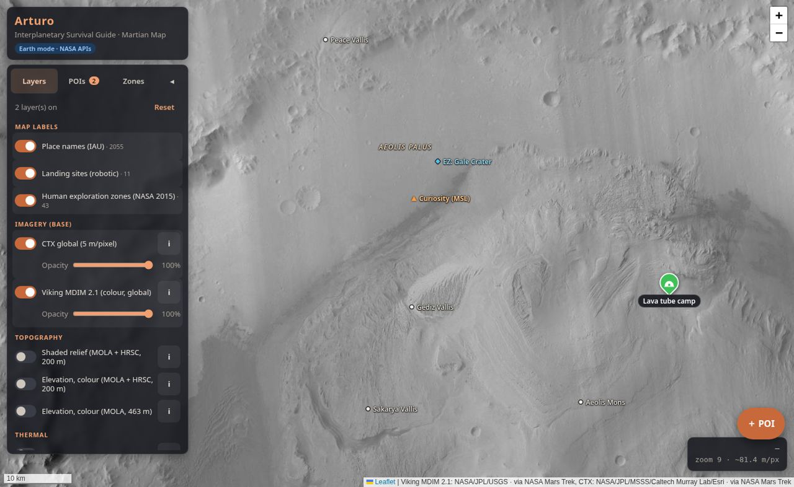 |
| **Geologic map with a categorical legend** | **Manual POIs: add with a button, tap, fill the form** |
|  | 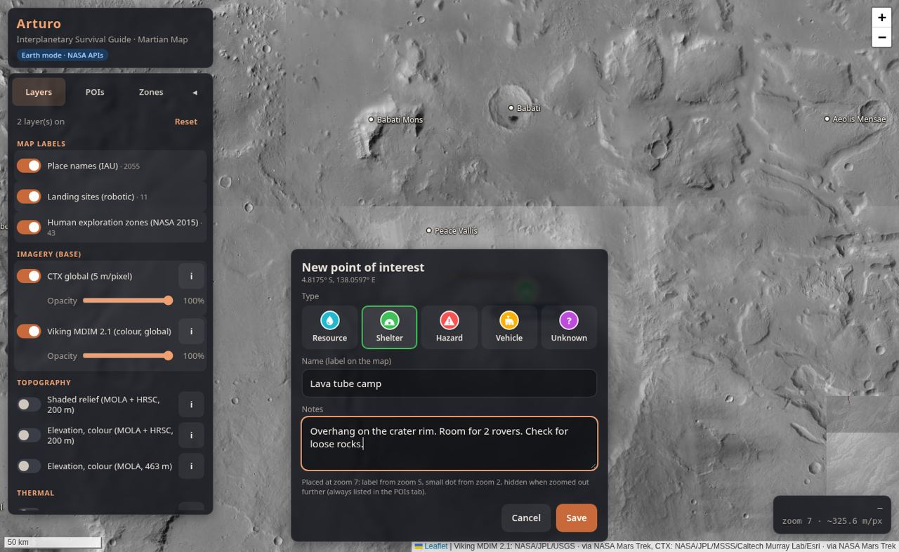 |

| Phase 2: tap the map for exact values (Gale, thermal section open) | Olympus Mons summit: 21 km, 91 Pa (live 200 m DEM) |
|---|---|
| 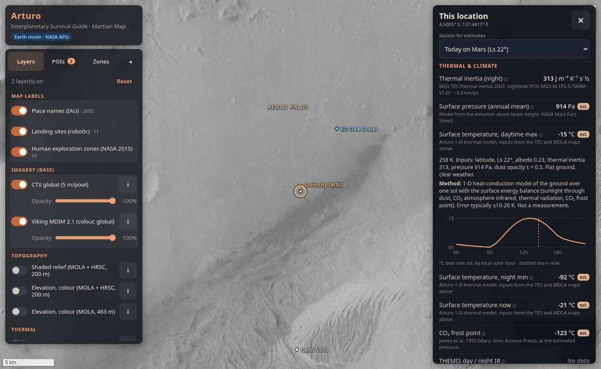 | 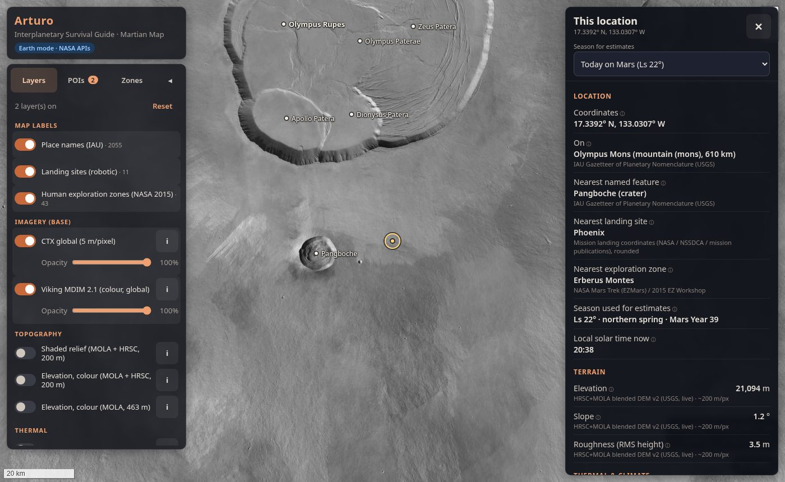 |
| **ⓘ Info on a POI opens the same panel** | **Phone: bottom sheet (radiation & safety)** |
| 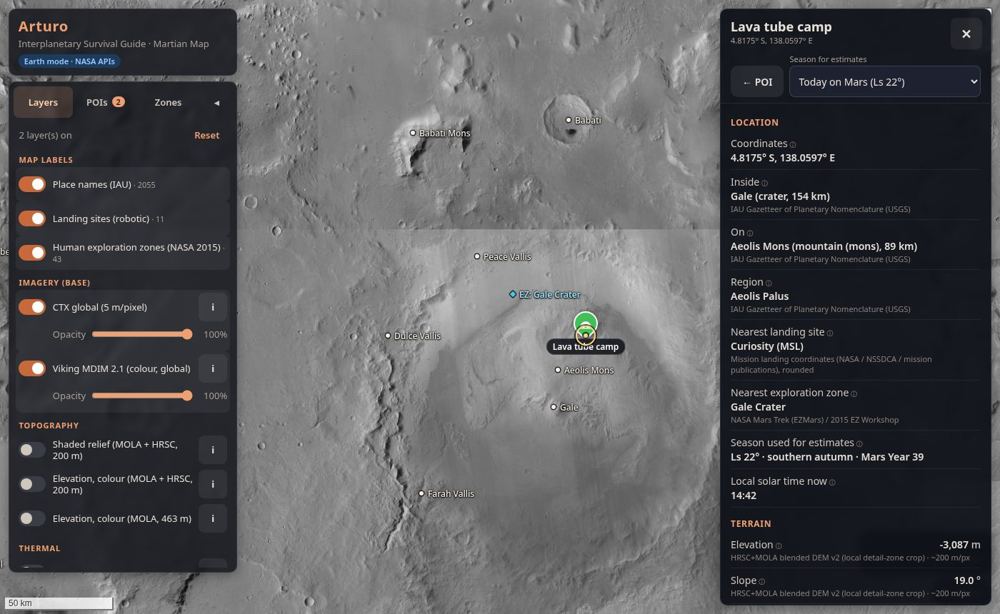 | 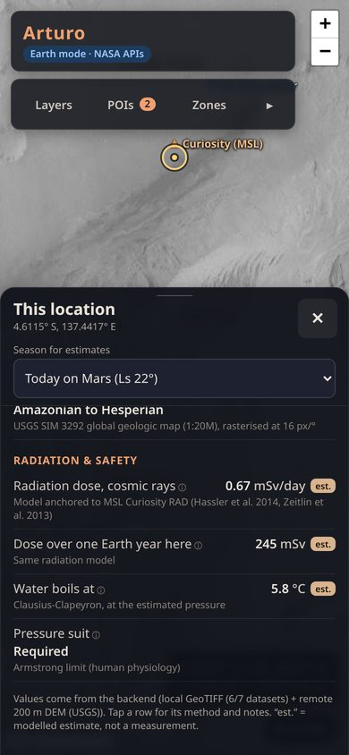 |

| Phase 3: route from the Curiosity landing site to the Mount Sharp foothills, hazards on the line and in the list | Drag the line to deviate: hazards recomputed (6 warnings → 4) |
|---|---|
| 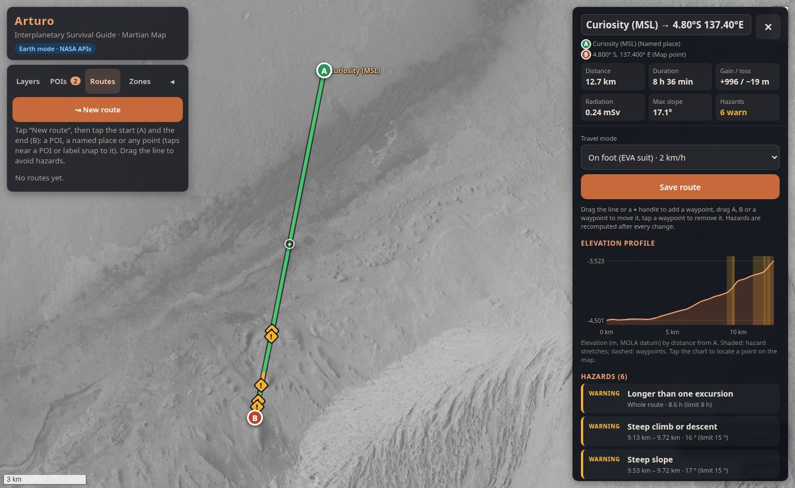 | 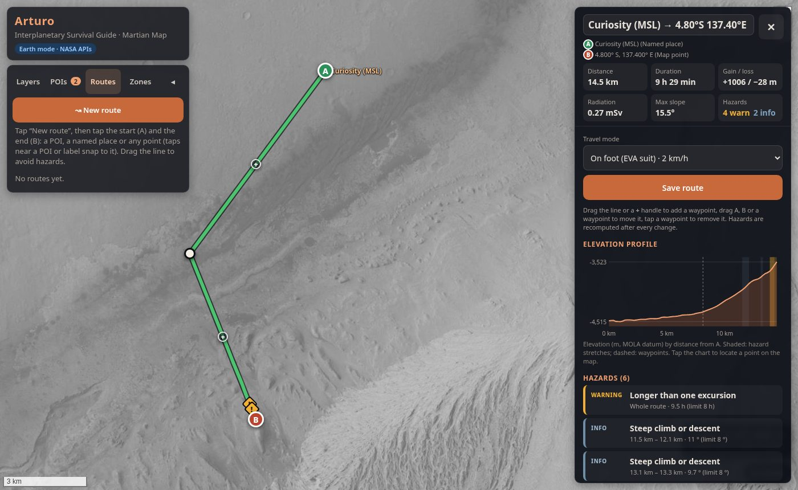 |
| **Tap a hazard: the map flies to it and highlights it** | **Phone: bottom sheet, touch-dragged waypoint** |
| 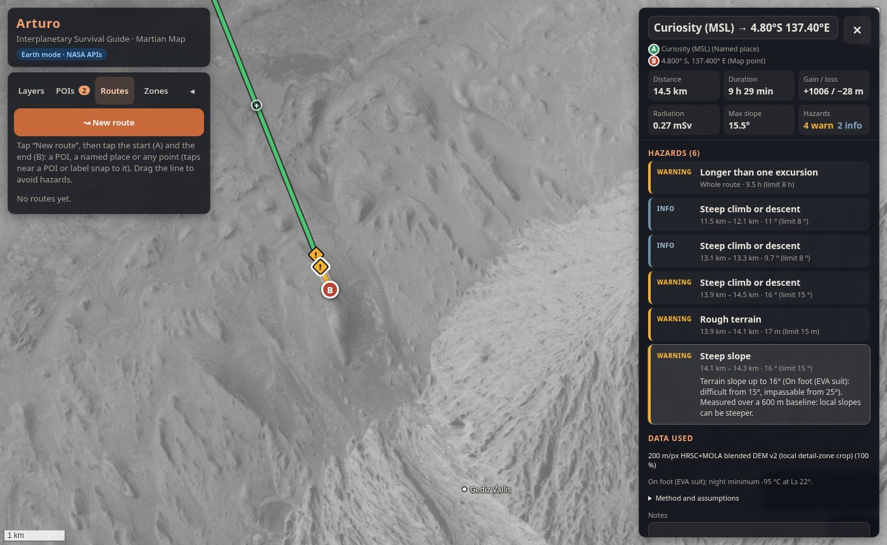 | 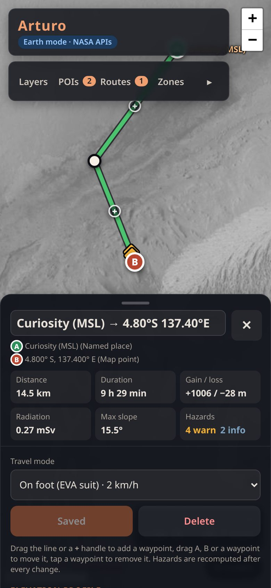 |

| Phase 4: straight line from Curiosity up Mount Sharp, 23.4° max slope | **✦ Auto: avoid hazards** — least-cost route via Gediz Vallis, 14.4° max |
|---|---|
| 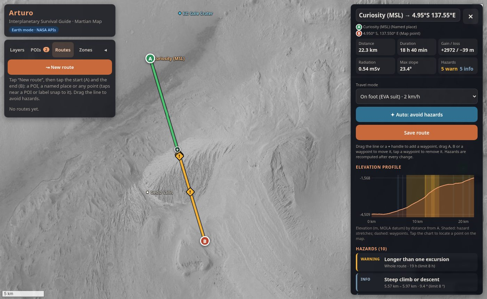 | 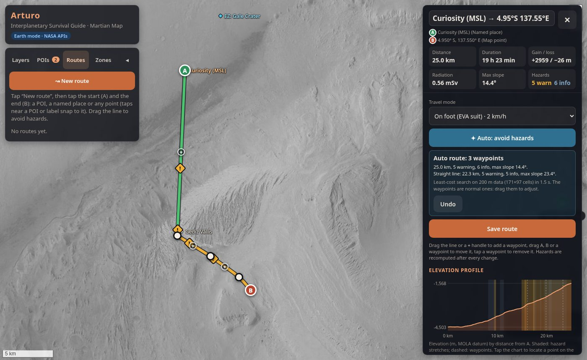 |
| **Auto route to the foothills, compared with the straight line** | **Clear refusal when B is on a 30° slope** |
| 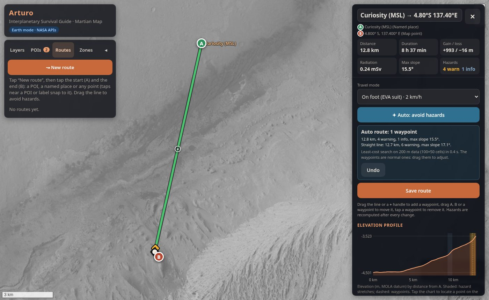 | 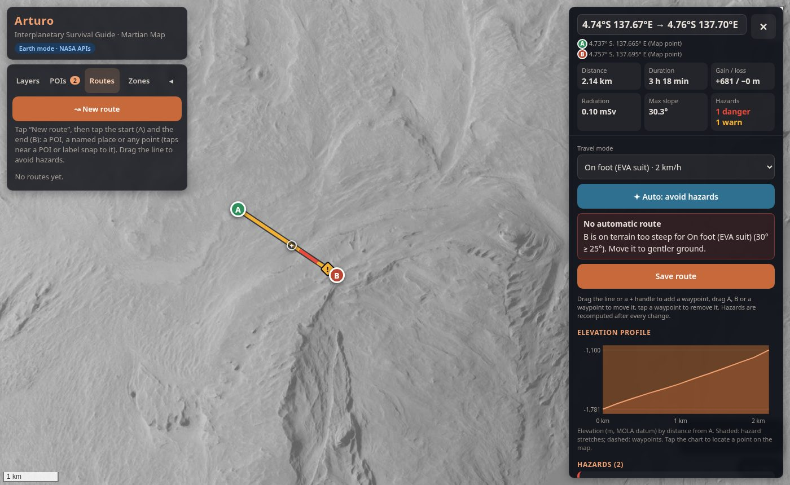 |

---

## Table of contents

1. [The challenge and our approach](#1-the-challenge-and-our-approach)
2. [Current status](#2-current-status)
3. [Architecture](#3-architecture)
4. [Earth mode vs Mars mode](#4-earth-mode-vs-mars-mode)
5. [Repository structure](#5-repository-structure)
6. [Running the project step by step](#6-running-the-project-step-by-step)
7. [Environment variables](#7-environment-variables)
8. [API endpoints](#8-api-endpoints)
9. [Data sources and attributions](#9-data-sources-and-attributions)
10. [Roadmap](#10-roadmap)
11. [How to add a new layer](#11-how-to-add-a-new-layer)
12. [Decisions and why](#12-decisions-and-why)
13. [Known limitations](#13-known-limitations)
14. [Contributing (commits, branches)](#14-contributing)

---

## 1. The challenge and our approach

The challenge asks for a layered map of Mars, for one region or route,
that combines data from several NASA missions and helps an astronaut plan
a safe and scientifically interesting walk.

Interactive viewers such as NASA Mars Trek already exist, but they are
built for scientists on Earth with a permanent Internet connection. Our
angle is different:

- **A survival guide, not a viewer**: routes that avoid dangerous slopes,
  radiation and temperature warnings by time and season, points of
  interest (water ice, shelter, science targets).
- **Offline-first**: a radio signal takes **4 to 24 minutes** each way
  between Mars and Earth, so depending on a remote API is not realistic.
  Everything the astronaut needs lives on the device/habitat; updates
  arrive as packs.
- **Hybrid level-of-detail model**: the whole planet at low resolution
  (always available, a few GB) plus downloadable **detail zones** at high
  resolution (rover sites like Gale and Jezero, and candidate human
  landing regions with shallow ice like Arcadia Planitia and Deuteronilus
  Mensae).

## 2. Current status

**Phase 1 — done ✅**: global Mars map with pan, zoom and level of detail
(LOD), base satellite imagery, backend tile proxy with interchangeable
data providers (Earth/Mars), disk cache that doubles as an offline pack,
detail-zones menu (auto-zoom; detailed data comes later).

**Phase 1b — done ✅**:

- **16 global layers** from NASA Mars Trek (imagery, topography, thermal,
  surface properties, mineralogy, geology, hydrology), each one verified
  to serve tiles and to line up with the base. A layer panel lets you
  switch each one on/off, set its opacity and reorder it (touch-friendly,
  remembered between visits).
- **A legend per layer**, with its metadata coming from the backend. Where
  NASA does not publish the colour ramp, the legend says so: it is marked
  *qualitative* and cites the source.
- **Map labels**: ~2,000 IAU place names (craters, valleys, mountains…),
  11 robotic landing sites and 43 candidate human exploration zones.
  They are served by `GET /api/features` from pre-built GeoJSON files, so
  this **works offline**. Labels are hidden by **importance** (size and
  type) and by **on-screen collision**, so the map never gets cluttered.
- **Manual points of interest (POIs)**: tap **＋ POI**, then tap the map.
  No right-click is needed, so it works on touch screens. A POI has an
  icon type (resource, shelter, hazard, vehicle, unknown), a name and
  notes. It remembers the **zoom it was created at**. A POI created
  zoomed in is a *local* POI and hides when you zoom far out. A POI
  created zoomed out is a *world-view* POI and is always shown. POIs can
  be edited and deleted. They are stored by the backend (`/api/pois`)
  behind a storage abstraction (JSON file today, database later).

**Phase 2 — done ✅**: **tap anywhere for exact values.** A tap or click
on the map (or **ⓘ Info** on a POI card) opens a location panel (side
panel on desktop, bottom sheet on phones) with:

- **Location**: coordinates, the crater it is inside / mountain it is
  on, nearest named feature, region, nearest landing site and human
  exploration zone, today's Mars season (Ls) and local solar time.
- **Terrain**: elevation (200 m DEM where available, MOLA elsewhere),
  slope with a trafficability class, roughness.
- **Thermal & climate**: thermal inertia, surface pressure, **estimated
  surface temperature** (daytime max, night min, now, and a curve over
  the sol) for today's season or a chosen Ls, CO₂ frost point.
- **Surface & composition**: albedo, dust cover index, TES minerals.
- **Geology**: SIM 3292 unit and age.
- **Radiation & safety**: cosmic-ray dose (scaled from Curiosity RAD),
  yearly dose, days to the NASA career limit, water boiling point.

Every value shows its unit, source dataset and resolution, and a tap
reveals the method. Modelled values carry an **est.** badge; places a
dataset does not cover say **No data**. The numbers come from real
numeric rasters (PDS / USGS / ASU GeoTIFFs, ≈ 61 MB in git, built by a
reproducible script), never from the coloured tiles, through `GET
/api/point`. Works offline in Mars mode.

**Phase 3 — done ✅**: **hand-drawn routes with hazards.** Tap **↝ Route**
(or *New route* in the Routes tab), tap the start **A** and the end **B**.
A and B can be your POIs, named places (labels) or any point: a tap within
28 px of a POI or label snaps to it. A straight line (a great circle on
the Mars sphere) is drawn and analysed by the backend:

- **Statistics**: distance, walking/driving time, elevation gain and
  loss, cosmic-ray dose for the trip, max slope, night minimum.
- **Elevation profile** with the hazard stretches shaded.
- **Hazards**, each with severity (info / warning / danger), where it
  starts and ends (km from A), its worst value and the limit it
  crossed: steep or impassable slope, steep climbs/descents, rough
  ground, soft ground, dust, extreme night cold, thin air, higher
  radiation, crater rim crossings, no data / coarse data, rover
  walk-back distance, too long for one excursion, trip dose.
- **The line is coloured** by the worst severity of each stretch
  (green / amber / red, grey dashed = no data) with ◆ markers on
  warnings and dangers. Tapping a hazard (list, marker or profile)
  flies the map to it and highlights it.
- **Google-Maps-like editing, made for touch** (no right-click): grab
  the line anywhere (or a **+** midpoint handle) and drag to add a
  waypoint, drag A/B/waypoints to move them, tap a waypoint →
  *Remove waypoint*. After each drop the route is re-analysed
  (debounced, with a loading indicator).
- **Travel mode**: on foot (EVA suit, 2 km/h, Tobler's hiking function)
  or pressurised rover (8 km/h). Modes and **every threshold** live in
  `backend/app/catalog/routes.yaml` with their sources.
- **Saved like POIs** (`/api/routes`, JSON file behind a
  `RouteRepository`), listed in the Routes tab to reopen, edit or
  delete.

Routes are sampled at the resolution of the best elevation data on the
way (200 m in the Gale/Jezero crops and live in Earth mode for short
routes, MOLA ~3.7 km elsewhere); the panel always says which data and
resolution were used. Routing is **manual** for now: you move the line,
the app tells you what is dangerous. Automatic suggestions come later.

**Phase 4 — done ✅**: **automatic hazard-avoiding routes.** In the
route panel, **✦ Auto: avoid hazards** asks the backend for the
least-cost path from A to B and replaces the waypoints with it. They are
ordinary waypoints, so the route stays editable (drag, remove, save), and
*Undo* restores the previous ones.

- The backend builds a **time-based cost grid** around A and B (a margin
  of 30 % of the route's size) from the best elevation data available
  (the same `RasterSource` stack: 200 m crops, the live 200 m DEM in
  Earth mode, MOLA). Each cell costs the time to cross it: Tobler's hiking
  function of the terrain slope on foot, the rover's linear slowdown by
  rover, ×3 above the *difficult* slope (15°), ×1.5/×4 on rough ground.
  Cells above the *impassable* slope (25°), a one-pixel clearance around
  them and cells without data are excluded.
- **scikit-image** (`MCP_Geometric`, Dijkstra on the 8-connected grid)
  finds the cheapest path. It sits behind a small `GridPlanner` interface
  so a custom A* can replace it later.
- The pixel path becomes a handful of waypoints (line-of-sight shortcuts
  that never cross an excluded cell and cost at most 5 % more), then goes
  through the normal route analysis, so hazards, profile and colours are
  the same as for a hand-drawn route.
- The panel compares the result with the straight line and says which
  data, resolution and grid were used. When no route exists it explains
  why (e.g. *B is on terrain too steep*, or *B is cut off by slopes ≥ 25°*,
  with a *Search a larger area* button), and it refuses routes crossing
  180° E/W, beyond ±80° latitude or longer than 600 km.
- All weights live in `backend/app/catalog/routes.yaml` → `planning`, and
  every request can override them (`weights`).

Demo (Curiosity landing site → Mount Sharp foothills, on foot):

| Route | Distance | Warnings | Max slope |
|---|---|---|---|
| Straight line | 12.7 km | 6 | 17.1° |
| Manual reroute (Phase 3) | 14.5 km | 4 (+2 info) | 15.5° |
| **Auto** | **12.8 km** | **4 (+1 info)** | **15.5°** |

Further up Mount Sharp (4.95° S 137.55° E) the auto route detours via
Gediz Vallis: 25.0 km instead of 22.3 km, with a 14.4° max slope instead
of 23.4°.

See the [roadmap](#10-roadmap) for what comes next.

---

## 3. Architecture

Monorepo with two top-level folders:

- **`frontend/`** — React + Vite + Leaflet (react-leaflet). 2D only.
- **`backend/`** — Python + FastAPI, rasterio + numpy for the numeric
  GeoTIFF point queries and route analysis; scikit-image + SciPy for
  automatic route planning.

The **golden rule**: *the frontend only talks to our backend*. The backend
is a black box that decides where the data comes from.

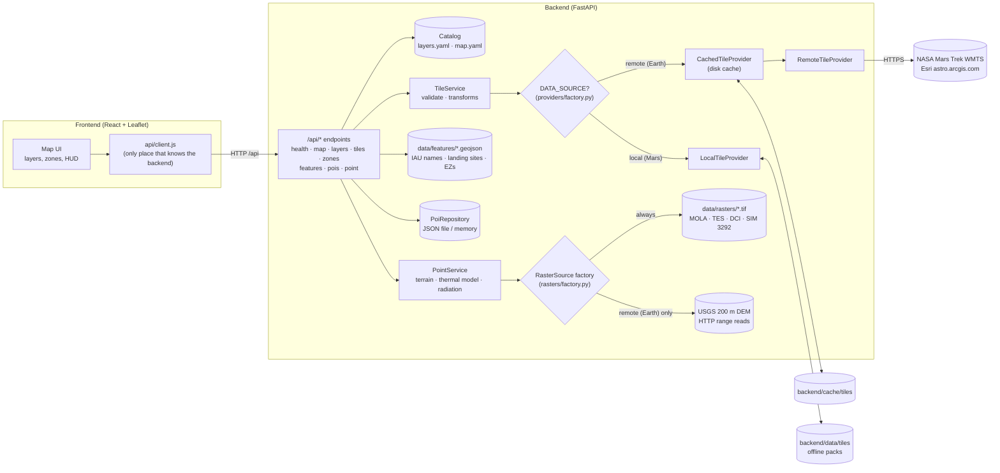

Key pieces:

| Piece | Where | Role |
|---|---|---|
| Layer catalog | `backend/app/catalog/layers.yaml` | Single source of truth: which layers exist, their tile grid, zoom ranges, attribution and (privately) their remote URL. |
| Map config & zones | `backend/app/catalog/map.yaml` | Initial view, zoom limits, Mars radius, detail zones, POI categories and POI zoom rules. |
| Feature repository | `backend/app/repositories/features.py` | Reads the pre-built label GeoJSON files and answers bbox + zoom queries (handles the ±180° line). |
| POI repository | `backend/app/repositories/pois.py` | `PoiRepository` interface with in-memory and JSON-file stores. A database store would be one new class. |
| `TileProvider` interface | `backend/app/providers/base.py` | `get_tile(layer, z, x, y) -> Tile`. Any source implements just this. |
| Provider factory | `backend/app/providers/factory.py` | **The one Earth/Mars switch**, driven by `DATA_SOURCE`. |
| `RasterSource` interface | `backend/app/rasters/` + `app/catalog/rasters.yaml` | Numeric values at a point (rasterio windowed reads of local GeoTIFFs, or a remote GeoTIFF over HTTP range requests in Earth mode). Same Earth/Mars rule as the tiles. |
| Point service | `backend/app/services/point.py` (+ `terrain.py`, `thermal.py`, `environment.py`, `mars_time.py`) | Builds the `/api/point` answer: raster values + models, each with unit, source, resolution and method. |
| Location panel | `frontend/src/components/PointPanel.jsx`, `PointQuery.jsx` | Map tap → `/api/point` → generic renderer of sections/items. |
| API client | `frontend/src/api/client.js` | The only frontend file that calls the backend. |
| Map component | `frontend/src/components/MarsMap.jsx` | Renders whatever layers `/api/layers` announces, with the options it sends. |
| Labels | `frontend/src/components/FeatureLabels.jsx` + `map/declutter.js` | Fetches labels for the visible area and hides the ones that would overlap. |
| POIs | `frontend/src/components/PoiLayer.jsx`, `PoiSheet.jsx`, `hooks/usePois.js` | Shows, creates, edits and deletes POIs through the API. |

More detail: [`backend/README.md`](backend/README.md) and
[`frontend/README.md`](frontend/README.md).

## 4. Earth mode vs Mars mode

| | 🌍 Earth mode (hackathon demo) | 🔴 Mars mode (deployment on Mars) |
|---|---|---|
| Setting | `DATA_SOURCE=remote` (default) | `DATA_SOURCE=local` |
| Where tiles come from | NASA Mars Trek / Esri over the Internet | Local folder (`LOCAL_TILES_DIR`); later a local DB or Martian network |
| Cache | Every visited tile is saved in `backend/cache/tiles` | — |
| Frontend changes | — | **none** |
| Backend changes | — | **none** (an env var). A brand-new kind of source = one new provider class + one line in the factory |
| Labels (`/api/features`) | Local GeoJSON files (already offline) | Same files |
| POIs (`/api/pois`) | JSON file (`POI_STORE=json`) | Same, or a future database / synced store behind `PoiRepository` |

How to switch:

```bash
# in backend/.env
DATA_SOURCE=local
LOCAL_TILES_DIR=./data/tiles     # or ./cache/tiles to reuse what you browsed
```

The cache and the offline packs use **the same folder layout**
(`{layer}/{z}/{x}/{y}.{ext}`), so a demo can be: browse a zone with
Internet → cut the network → switch to Mars mode → everything you
visited keeps working. The header badge in the UI shows the active mode.
Packs can also be built in advance with `backend/scripts/prefetch_tiles.py`:

```bash
cd backend
python -m scripts.prefetch_tiles --layer all --max-level 3   # every layer, whole planet, ~89 MB
```

Labels (`/api/features`) are already local files, so they work in both
modes with no extra step.

---

## 5. Repository structure

```
Arturo/
├── README.md                 ← you are here
├── docs/img/                 screenshots used in the READMEs
├── backend/                  Python API (FastAPI)
│   ├── README.md             backend docs (setup, API, architecture)
│   ├── requirements.txt      runtime dependencies
│   ├── requirements-dev.txt  + pytest, pyshp (feature build script)
│   ├── .env.example          all settings, commented
│   ├── app/
│   │   ├── main.py           FastAPI app, CORS, routers, provider lifecycle
│   │   ├── core/config.py    settings from env vars / .env
│   │   ├── api/              endpoints: health, map, layers, tiles, features, pois, point, routes
│   │   ├── catalog/          layers.yaml, map.yaml, rasters.yaml, routes.yaml and their loaders
│   │   ├── models/           Pydantic models (internal vs public contract)
│   │   ├── providers/        TileProvider + remote / local / cached + factory
│   │   ├── rasters/          RasterSource + GeoTIFF / multi-file / layered + factory
│   │   ├── repositories/     feature (labels), POI and route storage abstractions
│   │   └── services/         TileService, transforms, label ranking, point service,
│   │                         terrain, thermal model, environment, Mars time,
│   │                         geodesy (great circles), route_analysis (hazards),
│   │                         route_planner (least-cost path)
│   ├── scripts/              prefetch_tiles.py (offline packs), build_features.py (labels),
│   │                         build_rasters.py (numeric GeoTIFFs)
│   ├── data/features/        label GeoJSON (IAU names, landing sites, EZs) — in git
│   ├── data/rasters/         numeric GeoTIFFs for /api/point (~61 MB) — in git
│   ├── data/pois/            user POIs (pois.json, not in git)
│   ├── data/routes/          user routes (routes.json, not in git)
│   ├── data/tiles/           offline packs (contents not in git)
│   └── tests/                pytest suite (offline)
└── frontend/                 Web app (React + Vite + Leaflet)
    ├── README.md             frontend docs
    ├── package.json
    ├── vite.config.js        dev server + /api proxy
    ├── .env.example
    └── src/
        ├── api/client.js     backend client (only place with the API URL)
        ├── hooks/            useBackendData, useLayerState, useLabelState, usePois,
        │                     useRoutes, useRouteAnalysis, useRoutePlan
        ├── map/              Mars CRS, URL hash, label declutter, POI icons and zoom rules,
        │                     route helpers (snapping, colours)
        └── components/       MarsMap, Sidebar (Layers / POIs / Routes / Zones), LayersPanel,
                              LegendPanel, FeatureLabels, PoiLayer, PoiSheet, PoiPanel,
                              PointQuery, PointPanel, Sparkline, RouteLayer, RoutePanel,
                              RouteProfile, RoutesPanel, …
```

---

## 6. Running the project step by step

You need **two terminals**: one for the backend and one for the frontend.

### Requirements

- **Python 3.10 or newer** — https://www.python.org/downloads/
  (Windows: tick "Add Python to PATH" in the installer).
- **Node.js 20.19+ or 22.12+** (LTS recommended) — https://nodejs.org/
- **Git** — https://git-scm.com/
- Internet connection (Earth mode downloads tiles from NASA).

### 0. Clone

```bash
git clone https://github.com/JorgeGomezSanchez/Arturo.git
cd Arturo
```

### 1. Backend (terminal 1)

**Linux / macOS**

```bash
cd backend
python3 -m venv .venv
source .venv/bin/activate
pip install -r requirements.txt
cp .env.example .env            # optional
uvicorn app.main:app --reload --port 8000
```

**Windows (PowerShell)**

```powershell
cd backend
py -3 -m venv .venv
.\.venv\Scripts\Activate.ps1     # if blocked: Set-ExecutionPolicy -Scope CurrentUser RemoteSigned
pip install -r requirements.txt
copy .env.example .env           # optional
uvicorn app.main:app --reload --port 8000
```

**fish shell**: activate with `source .venv/bin/activate.fish` (the
plain `activate` script is for bash/zsh).

**Windows (cmd.exe)**: same as PowerShell but activate with
`.venv\Scripts\activate.bat`.

Check that it is running:

- http://localhost:8000/ — a small JSON index with links to everything
  below. Earlier versions returned `404` here because the API lives under
  `/api`. That was by design, but it was confusing, so the root now shows
  this index.
- http://localhost:8000/api/health — status and active data source.
- http://localhost:8000/docs — **interactive API docs** (Swagger UI): every
  endpoint, its parameters and a "Try it out" button. This is the easiest
  way to explore the API. ReDoc is at `/redoc`.

### 2. Frontend (terminal 2) — same on every OS

```bash
cd frontend
npm install
npm run dev
```

Open **http://localhost:5173** 🚀

Tips:

- Shareable views: the URL keeps `#zoom/lat/lon`, e.g.
  http://localhost:5173/#6/-5.4/137.8 is Gale crater.
- The first visit to an area is slower (tiles come from NASA); after that
  they come from the backend's disk cache.
- **Layers** tab: switch layers on/off, change opacity, move them up/down,
  and open the legend of each one (ⓘ). **POIs** tab: your points of
  interest. **Zones** tab: detail zones.
- Add a POI: tap **＋ POI** (bottom right), tap the map, fill the form.
  Press `Esc` or *Cancel* to stop placing.
- Draw a route: tap **↝ Route**, tap A, tap B. Drag the line to deviate
  it, or tap **✦ Auto: avoid hazards** in the route panel, then *Save
  route*. Saved routes are in the **Routes** tab.

### 3. Tests (optional)

```bash
cd backend
pip install -r requirements-dev.txt
python -m pytest -q   # 60 tests, offline
```

Updating an existing checkout? Run `pip install -r requirements.txt`
again after `git pull`: Phase 4 added **scikit-image** and **SciPy**
(binary wheels, nothing to compile).

---

## 7. Environment variables

### Backend (`backend/.env`, see `backend/.env.example`)

| Variable | Default | Description |
|---|---|---|
| `DATA_SOURCE` | `remote` | `remote` = Earth mode (NASA APIs + cache), `local` = Mars mode (disk only). |
| `LOCAL_TILES_DIR` | `./data/tiles` | Offline packs for local mode. |
| `TILE_CACHE_ENABLED` | `true` | Save downloaded tiles to disk in remote mode. |
| `TILE_CACHE_DIR` | `./cache/tiles` | Cache folder (same layout as the packs). |
| `REMOTE_TIMEOUT_S` | `15` | Timeout for NASA/Esri requests. |
| `REMOTE_USER_AGENT` | `Arturo/0.1 (...)` | User-Agent for remote requests. |
| `LAYERS_FILE` | `app/catalog/layers.yaml` | Layer catalog. |
| `MAP_FILE` | `app/catalog/map.yaml` | Map config, zones, POI categories and zoom rules. |
| `FEATURES_DIR` | `./data/features` | Folder with the label GeoJSON files served by `/api/features`. |
| `POI_STORE` | `json` | POI storage: `json` (file, survives restarts) or `memory` (lost on restart). |
| `POI_STORE_FILE` | `./data/pois/pois.json` | File used by the JSON POI store (created on first write). |
| `RASTERS_DIR` | `./data/rasters` | Numeric GeoTIFFs for `/api/point` and route analysis. |
| `ROUTE_STORE` | `json` | Route storage: `json` (file) or `memory`. |
| `ROUTE_STORE_FILE` | `./data/routes/routes.json` | File used by the JSON route store. |
| `ROUTES_FILE` | `app/catalog/routes.yaml` | Travel modes and hazard thresholds. |
| `POINT_REMOTE_DEM` | `true` | Earth mode: read the USGS 200 m DEM live where no local crop exists (ignored in Mars mode). |
| `POINT_REMOTE_TIMEOUT_S` | `8` | Timeout for those reads (then MOLA is used for 5 minutes). |
| `CORS_ORIGINS` | `http://localhost:5173,...` | Allowed origins when not using the Vite proxy. |

### Frontend (`frontend/.env.local`, see `frontend/.env.example`)

| Variable | Default | Description |
|---|---|---|
| `VITE_API_URL` | *(empty = same origin)* | Backend URL as seen by the browser. Leave empty in development. |
| `VITE_DEV_BACKEND` | `http://127.0.0.1:8000` | Target of the Vite dev proxy for `/api`. |

---

## 8. API endpoints

Interactive docs at http://localhost:8000/docs.

| Method | Path | Description | Phase |
|---|---|---|---|
| GET | `/api/health` | Status, version, data source (`remote`/`local`), active provider | 1 ✅ |
| GET | `/api/map` | CRS, Mars radius, initial view, zoom limits, bounds | 1 ✅ |
| GET | `/api/layers` | Layers with Leaflet-ready options; `tileUrl` points to our backend | 1 ✅ |
| GET | `/api/layers/{id}` | One layer | 1 ✅ |
| GET | `/api/tiles/{layer}/{z}/{x}/{y}` | Tile image (404 = no data, 502 = source failed) | 1 ✅ |
| GET | `/` | Small JSON index with links (`/docs`, `/api/health`, …) | 1b ✅ |
| GET | `/api/zones` | Detail zones for the side menu | 1 ✅ (stub data) |
| GET | `/api/features?bbox=&zoom=&categories=&limit=` | Map labels (IAU names, landing sites, exploration zones) visible in a bbox at a zoom, most important first (GeoJSON) | 1b ✅ |
| GET | `/api/features/categories` | Label categories with counts | 1b ✅ |
| GET | `/api/features/{id}` | One label feature | 1b ✅ |
| GET | `/api/pois?bbox=` | Manual POIs (GeoJSON FeatureCollection) | 1b ✅ |
| POST | `/api/pois` | Create a POI → `201` + GeoJSON Feature | 1b ✅ |
| GET / PUT / DELETE | `/api/pois/{id}` | Read, update or delete one POI | 1b ✅ |
| GET | `/api/pois/categories` | POI icon types with label, description and colour (the zoom rules are in `/api/map` → `poiVisibility`) | 1b ✅ |
| GET | `/api/point?lat=&lon=[&ls=][&tau=]` | Everything known about a location: sections of values, each with unit, source, resolution, method, `noData` and `estimate` flags | 2 ✅ |
| GET | `/api/routes` | Saved routes (GeoJSON LineStrings with summary `stats`) | 3 ✅ |
| POST | `/api/routes` | Create a route (A, B, waypoints, mode…) → `201`, analysed on save | 3 ✅ |
| GET / PUT / DELETE | `/api/routes/{id}` | Read, update (re-analysed) or delete one route | 3 ✅ |
| GET | `/api/routes/{id}/analysis[?ls=]` | Full analysis of a saved route | 3 ✅ |
| POST | `/api/routes/analyze` | Analyse a line without saving: profile, hazards, coloured segments, distance, time, dose | 3 ✅ |
| POST | `/api/routes/plan` | Plan a hazard-avoiding route `{start, end, mode, weights?}` → waypoints + analysis + straight-line summary + how it was computed; `422 {reason, message, …}` when impossible | 4 ✅ |
| GET | `/api/routes/config` | Travel modes and hazard thresholds (`routes.yaml`) | 3 ✅ |

---

## 9. Data sources and attributions

| Data | Provider / credits | Used for | Link |
|---|---|---|---|
| Viking MDIM 2.1 colour mosaic, ~232 m/px | NASA / JPL / USGS, served by NASA Mars Trek | Global colour base (zoom 0-7+) | [WMTS capabilities](https://trek.nasa.gov/tiles/Mars/EQ/Mars_Viking_MDIM21_ClrMosaic_global_232m/1.0.0/WMTSCapabilities.xml) |
| CTX global mosaic, ~5 m/px | NASA / JPL / MSSS / Caltech Murray Lab / Esri; listed in NASA Mars Trek, tiles from Esri's `astro.arcgis.com` | High-resolution base (zoom 7+) | [WMTS capabilities](https://trek.nasa.gov/tiles/Mars/EQ/CTX_beta01_uncontrolled_5m_Caltech/1.0.0/WMTSCapabilities.xml) · [Esri MapServer](https://astro.arcgis.com/arcgis/rest/services/OnMars/CTX/MapServer) |
| MOLA colour hillshade, 463 m/px | NASA / JPL / GSFC (MGS MOLA) | Colour elevation | [Mars Trek](https://trek.nasa.gov/mars/) |
| MOLA + HRSC blend, 200 m/px (colour and grey shaded relief) | NASA / JPL / GSFC / ESA / DLR / FU Berlin / USGS | Colour elevation, shaded relief | [Mars Trek](https://trek.nasa.gov/mars/) |
| THEMIS day and night IR controlled mosaics, 100 m/px | NASA / JPL / ASU (Edwards et al. 2011; USGS 2018) | Thermal imagery | [Mars Trek](https://trek.nasa.gov/mars/) |
| TES thermal inertia | NASA / JPL / ASU (Putzig et al. 2005) | Thermal inertia | [Mars Trek](https://trek.nasa.gov/mars/) |
| TES albedo, TES dust cover index | NASA / JPL / ASU (Ruff & Christensen 2002) | Surface brightness and dust | [Mars Trek](https://trek.nasa.gov/mars/) |
| MOLA roughness | NASA / GSFC (Kreslavsky & Head 2000) | Surface roughness | [Mars Trek](https://trek.nasa.gov/mars/) |
| TES mineral maps (high-Ca pyroxene, plagioclase, sheet silicates/glass) | NASA / JPL / ASU (Bandfield 2002) | Mineralogy | [Mars Trek](https://trek.nasa.gov/mars/) |
| Geologic map of Mars, SIM 3292 | Tanaka et al. 2014, USGS | Geology (categorical legend with 44 units) | [USGS](https://doi.org/10.3133/sim3292) |
| Valley networks | Hynek et al. 2010 | Ancient valleys | [Mars Trek](https://trek.nasa.gov/mars/) |
| **Numeric rasters for `/api/point`** (all in `backend/data/rasters/`) | MOLA MEGDR 16 px/° (Smith et al. 2003, PDS); HRSC+MOLA blended DEM v2 200 m (Fergason et al. 2018, USGS); TES thermal inertia 2007 (Putzig & Mellon 2007, PDS); TES Lambert albedo (Christensen et al. 2001, USGS); dust cover index (Ruff & Christensen 2002, ASU); TES mineral maps (Bandfield 2002, ASU); SIM 3292 (Tanaka et al. 2014, USGS) | Exact values at a point | [`backend/data/rasters/README.md`](backend/data/rasters/README.md) |
| Radiation anchor values | MSL RAD: Hassler et al. 2014 (Science 343, 0.67 mSv/day at Gale); Zeitlin et al. 2013 (Science 340, 1.84 mSv/day in cruise) | Radiation estimate | [doi:10.1126/science.1244797](https://doi.org/10.1126/science.1244797) |
| Route thresholds and speeds | Apollo EVA and LRV experience (walking speeds, 10–15° slopes found tiring, 25° LRV design slope, ~10 km walk-back rule, 7–8 h EVAs); Curiosity/Perseverance traverse planning (~15–20° risky); Tobler 1993 hiking function; angle of repose of loose granular material (~30–35°); Spirit's soft-soil entrapment (2009); dust cover index (Ruff & Christensen 2002); km-scale Hurst exponent of Mars topography (Orosei et al. 2003) | Route hazards (`routes.yaml`, each value commented) | [`backend/README.md` §12](backend/README.md#12-routes-apiroutes) |
| IAU Gazetteer of Planetary Nomenclature | IAU WGPSN / USGS Astrogeology | ~2,000 place-name labels | [Gazetteer](https://planetarynames.wr.usgs.gov/) |
| Human exploration zones (2015 workshop) | NASA, EZMars layer of Mars Trek | 43 candidate human landing zones | [EZMars MapServer](https://trek.nasa.gov/mars/trekarcgis/rest/services/EZMars/MapServer) |
| Robotic landing sites | Hand-curated from NASA/ESA/CNSA mission pages | 11 landing-site labels | `backend/data/features/README.md` |
| NASA Mars Trek | NASA Solar System Treks Project (JPL) | Tile services (WMTS) | https://trek.nasa.gov/mars/ |

Full layer metadata (resolution, coverage, legend, references with DOIs)
lives in `backend/app/catalog/layers.yaml` and is shown in each layer's
legend. Planned for later phases: HiRISE images and DTMs (MRO), NASA
Ames / Mars Climate Database fields (pressure, dust, temperature by
season).

Credits are one tap away behind the **ⓘ Credits** button in the map's
bottom-right corner. The panel lists only what is on screen: the tile
layers that are switched on and drawn at the current zoom (credit text
per layer in `layers.yaml`), the label groups that are on (credit text in
`map.yaml` → `label_credits`) and Leaflet.

---

## 10. Roadmap

| Phase | Goal | Main work |
|---|---|---|
| **1 ✅** | Global map | Whole-Mars 2D map with pan/zoom/LOD, base imagery (Viking + CTX), backend proxy with Earth/Mars providers, cache/offline packs, zones menu stub. |
| **1b ✅** | Layers, labels, POIs | 16 toggleable layers with legends; IAU / landing-site / exploration-zone labels with decluttering (`/api/features`); manual POIs with CRUD (`/api/pois`); layer panel with opacity and order. |
| **2 ✅** | Point query | Tap anywhere (or POI ⓘ Info) → location, terrain, thermal & climate, composition, geology, radiation & safety. Backend reads numeric GeoTIFFs with rasterio behind a `RasterSource` abstraction (200 m DEM crops / live USGS DEM / MOLA, TES, DCI, SIM 3292) plus small physical models → `GET /api/point`. |
| **3 ✅** | Manual routes with hazards | A → B between POIs, labels or any point; great-circle line analysed against the DEM and the Phase 2 rasters/models (slope, grade, roughness, soft ground, dust, cold, pressure, radiation, crater rims, no data); severity-coloured line, profile and hazard list; Google-Maps-like touch editing; CRUD (`/api/routes`). |
| **4 ✅** | Automatic routes | Time-based cost grid from the DEM (Tobler / rover slowdown, difficult-slope and roughness penalties, impassable slope and no-data excluded) → scikit-image least-cost path behind a swappable `GridPlanner` → simplified into waypoints → normal analysis (`POST /api/routes/plan`); "Auto" button with Undo. |
| **5** | Astronaut HUD preview *(planned, not implemented)* | A window that previews what an astronaut would see on the helmet HUD while following a route: current position, deviation from the planned route (cross-track distance and direction back to it), distance and ETA to the destination (and to the next waypoint), and only a few more strictly relevant items: the next hazard ahead (type, severity, distance), radiation dose accumulated so far, time left within the excursion limit. The estimated surface temperature is deliberately left out: the suit carries its own thermometer, and a modelled value would only add noise. Simulated by "walking" along a saved route; later fed by real positioning. |
| **Extras** | Survival guide | Detail-zone packs (HiRISE) downloadable from the side menu; time/season-aware temperature and radiation warnings; offline pack manager; Service Worker for a fully offline frontend; printable traverse plan. |

---

## 11. How to add a new layer

Example: a MOLA hillshade from Mars Trek.

1. Open its capabilities, e.g.
   `https://trek.nasa.gov/tiles/Mars/EQ/<LAYER_NAME>/1.0.0/WMTSCapabilities.xml`.
   Note: `ResourceURL template`, `TileWidth` (256/512), number of
   `TileMatrix` levels, `Format`. Use **EQ** (equirectangular) layers only.
2. Add an entry to `backend/app/catalog/layers.yaml`:

   ```yaml
   - id: my_new_layer
     name: "My new layer"
     description: "What it shows and why an astronaut cares"
     group: overlay            # toggleable (base = imagery under everything)
     category: topography      # panel section: imagery, topography, thermal, surface, composition, geology, hydrology
     default_visible: false
     format: png
     tile_size: 256
     levels: { min: 0, max: 7 }
     display: { min_zoom: 0, max_zoom: 18 }
     opacity: 0.6
     z_index: 15
     resolution_m: 463
     attribution: "…: NASA/JPL/… · via NASA Mars Trek"
     source:
       # WMTS {TileMatrix}/{TileRow}/{TileCol}  ->  {z}/{y}/{x}
       url_template: "https://trek.nasa.gov/tiles/Mars/EQ/<LAYER_NAME>/1.0.0/default/default028mm/{z}/{y}/{x}.png"
     legend:
       type: gradient          # gradient | categorical | channels | symbol
       title: "What the colours mean"
       quantitative: false     # true only if the source documents the values
       min_label: "Low"
       max_label: "High"
       stops: [ { color: "#000000" }, { color: "#ffffff" } ]
       notes: [ "Say honestly what is and is not known about the colours." ]
       sources: [ { name: "Product page", url: "https://…" } ]
   ```

3. Restart the backend and check `GET /api/layers` and
   `GET /api/tiles/my_new_layer/0/0/0`. Compare a tile against the Viking
   base at a high zoom to make sure it lines up.
4. Frontend: **nothing to do**. The layer appears in the Layers panel
   with its legend.

---

## 12. Decisions and why

| Decision | Alternatives | Why |
|---|---|---|
| **Leaflet** (react-leaflet) | OpenLayers | Simpler API and smaller learning curve for a hackathon; for a single 2D map it is more than enough. The one hard part —a non-Web-Mercator projection— is solved with Leaflet's built-in `L.CRS.EPSG4326`. OpenLayers handles exotic projections better but is slower to learn. |
| **FastAPI** | Flask | Automatic interactive docs (`/docs`) so frontend and backend people can work in parallel; request validation with Pydantic; native async, ideal for proxying many tile requests at once. |
| **React + Vite**, plain JS | Vue, TypeScript | Large ecosystem and react-leaflet; Vite is the fastest dev setup; plain JS keeps it approachable for the team. |
| **Equirectangular CRS** (EPSG:4326-like grid) | Web Mercator (EPSG:3857) | NASA Mars Trek's global tiles are equirectangular with a 2×1 level 0. Using the same grid means tiles line up with no reprojection, and lat/lon readouts are real Martian coordinates. Web Mercator would also distort the poles heavily. |
| **Mars radius in the CRS** | Leaflet default | Leaflet measures distances with Earth's radius; we override it with Mars' 3396.19 km so the scale bar and m/px are correct. |
| **Hybrid LOD model** | Whole planet at full resolution / a single zone | Global low-res imagery is a few GB and works everywhere; full-res global CTX is terabytes and HiRISE doesn't cover the whole planet. So: global base always + high-res detail zones. Routing also only makes sense at high resolution. |
| **Offline-first, backend as a black box** | Frontend calling NASA directly | On Mars there's no real-time API (4-24 min light delay). Hiding the source behind `TileProvider` means the Earth demo and the Mars deployment share 100 % of the frontend and almost all the backend. |
| **Viking + CTX stacked as the base** | Only CTX / only Viking | Viking is the only truly global colour base and looks best zoomed out; CTX gives ~5 m/px detail but looks flat grey at low zoom and has gaps. Stacking both (CTX from zoom 7, gaps transparent) gives the best of each. |
| **Catalog in YAML** | Hard-coded in Python/JS | Non-developers on the team can add layers/zones; comments allowed; one place to look. |
| **Cache layout = offline pack layout** | Separate formats | Browsing in Earth mode automatically produces a pack usable in Mars mode. |
| **Labels pre-built as GeoJSON, served by the backend** | Query the USGS Gazetteer live; label tiles | Works offline on Mars, files are small (~0.7 MB), and the backend can rank and filter by bbox/zoom. The frontend still decides the final on-screen layout because only it knows text sizes. |
| **Declutter in the browser (greedy, by priority)** | Server-side placement; Leaflet plugins | Collision depends on the font, the screen and the current view. A greedy pass in priority order with a grid index handles ~600 candidates in a few ms. |
| **POI visibility from `createdZoom`** | A manual "global/local" flag | It needs no extra choice from the user: what you mark while looking at the whole planet stays visible at that scale; what you mark at a single rock only appears near that zoom. |
| **scikit-image `MCP_Geometric` first** | A hand-written A* | Fast (a 170×100 grid in a few ms), tested, and grid-native; behind a `GridPlanner` interface so an A* with direction-aware costs (uphill vs downhill) can replace it without touching the API or the frontend. |
| **Auto route = ordinary waypoints** | A separate "planned route" type | No data-model change: the planned route is analysed, saved, edited and dragged exactly like a hand-drawn one, and the astronaut can always override the computer. |
| **Manual routes first** | Automatic A* right away | The astronaut keeps control and sees *why* a line is dangerous; the analyser written for it is exactly the cost function a later pathfinder needs. |
| **Thresholds only in `routes.yaml`** | Constants in code or in the frontend | Mission planners can tune them (and see their sources) without touching code; the frontend reads them from `/api/routes/config` and only knows colours. |
| **Sampling at the DEM's resolution** | Fixed step | Sampling a 3.7 km MOLA pixel every 50 m adds no information; sampling 200 m data every 2 km misses slopes. The spacing follows the best data on the way (≥ 50 m, ≤ 2,500 samples). |
| **POI storage behind `PoiRepository`** | Writing SQL/JSON directly in the endpoints | JSON file today; a database or a store synced between habitats tomorrow, with no API or frontend change. |
| **Honest legends** | Inventing value ranges | Several Trek products don't publish their colour ramp. A wrong number on a survival map is worse than "qualitative: high/low". |

---

## 13. Known limitations

- **CTX coverage**: ~99 % of the planet between ±88° latitude, with small
  gaps (transparent; Viking shows underneath). Beyond ±88° only Viking.
- **CTX is greyscale** and "uncontrolled" (not perfectly co-registered
  with other datasets; offsets of tens to hundreds of metres are possible
  in places). Fine for visualisation; precise work will use HiRISE/DTMs.
- **Max native resolution**: CTX level 12 (map zoom 13, ~5 m/px). Zooms
  14–16 upscale it. Esri's service returns HTTP 400 above level 12.
- **Third-party availability**: Earth mode depends on trek.nasa.gov and
  astro.arcgis.com being up. Visited tiles keep working from the cache.
- **Mars mode only serves what is in the pack**: unvisited / unpacked
  tiles return 404 (the map shows what it has).
- **No Service Worker yet**: the frontend itself still needs to be served
  (it is tiny and local in Mars mode; a PWA is on the roadmap).
- **Most legends are qualitative**: NASA Trek does not document the exact
  colour ramp of most products. The legends show the direction (low →
  high) and the source. Exact values are one tap away (location panel).
- **Coarse layers**: TES and roughness products are 3–16 km/pixel. They
  are blurry when zoomed in; their tiles only exist at levels 0–2 and are
  upscaled beyond that.
- **THEMIS coverage** is ±65° latitude. CTX stops at ±88°.
- **Labels**: only IAU names with an official centre point are included
  (2,055). Albedo features and small craters only appear when zoomed in.
  Labels are placed at a point, not along valleys.
- **Temperature is a model, not a measurement** (±10–20 K): flat
  ground, clear weather, fixed dust opacity, no seasonal memory (so
  seasonal CO₂ frost and polar ice are not represented; the panel warns
  above 55° latitude).
- **Radiation is a two-anchor scaling** of Curiosity RAD with the
  atmospheric column (±50 %); no solar storms, solar cycle or shielding.
- **Pressure** is an annual mean from the elevation (±10–15 % seasonal).
- **Resolution of point values**: elevation 200 m only in the Gale and
  Jezero crops (and live in Earth mode); elsewhere offline it is MOLA at
  ~3.7 km, so slopes are kilometre-scale. TES products are 3–15 km.
  Minerals below ~10–15 % are not significant. THEMIS has no absolute
  values (its mosaics are stretched images).
- **"Inside" / "region"** use the IAU centre and diameter as a circle;
  real outlines are not circles.
- **Automatic planning is a grid search**: the cost is isotropic
  (the terrain slope is treated as uphill in every direction, so descents
  are not cheaper), east–west distances use the cosine of the search
  area's middle latitude, only slope, roughness and no-data enter the
  cost (cold, dust, radiation and crater rims are reported by the
  analysis but not avoided), and the result is only as good as the DEM:
  on MOLA (~3.7 km) a "passable" grid can still hide cliffs. Planning is
  refused across 180° E/W, beyond ±80° latitude and above 600 km; big
  areas are coarsened (the response says so). A planned route can still
  carry warnings: when A or B themselves sit on steep ground, or the
  safest path is still long.
- **Route resolution**: 200 m elevation only inside the Gale/Jezero
  crops, or live in Earth mode for routes small enough (≤ ~80 DEM rows,
  roughly ≤ 30 km north–south; bigger blocks would take tens of seconds
  over HTTP, so MOLA ~3.7 km is used). With MOLA a 3.7 km pixel hides
  rims, scarps and boulders: slope is a kilometre-scale average and the
  panel adds a *coarse data* note. No HiRISE DTMs yet.
- **Simplified hazard geometry**: crater rims are circles from the IAU
  centre and diameter; temperature, pressure and radiation are the
  Phase 2 models (estimates); roughness is DEM-scale, not rock
  abundance; no lighting, communications or line-of-sight checks.
- **No antimeridian routes** (a route may not cross 180° E/W) and at
  most 200 waypoints.
- **POIs are not synced or authenticated**: one shared JSON file per
  backend, with no users and no conflict handling between devices.
- **Mars mode only serves cached layers**: a layer you never browsed (or
  never prefetched with `prefetch_tiles.py --layer all`) is empty offline.

---

## 14. Contributing

- Branch `main` holds working code. Use feature branches
  (`feat/point-query`, `fix/...`) and pull requests when several people
  work at once.
- Commits follow [Conventional Commits](https://www.conventionalcommits.org/)
  in English: `feat(backend): ...`, `fix(frontend): ...`, `docs: ...`,
  `test: ...`, `chore: ...`, with a body explaining **what and why**.
- Keep the READMEs up to date when you change behaviour or add endpoints.
